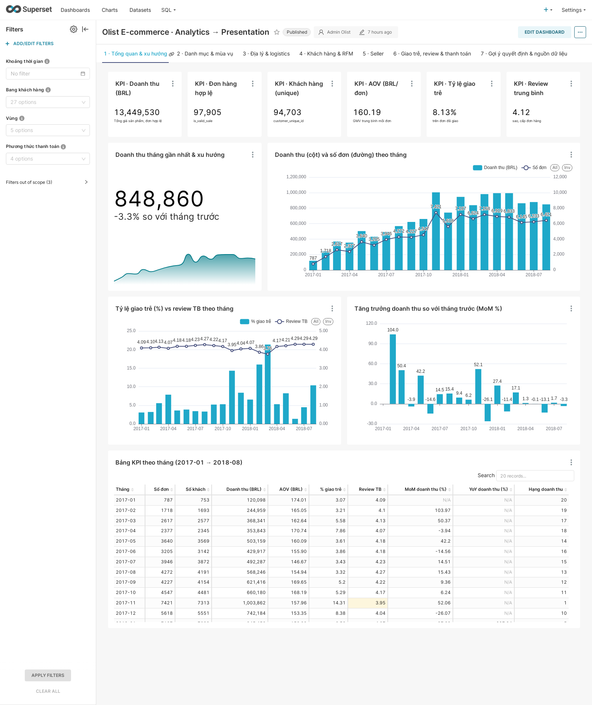
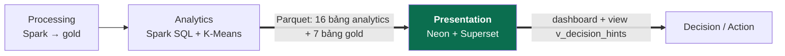
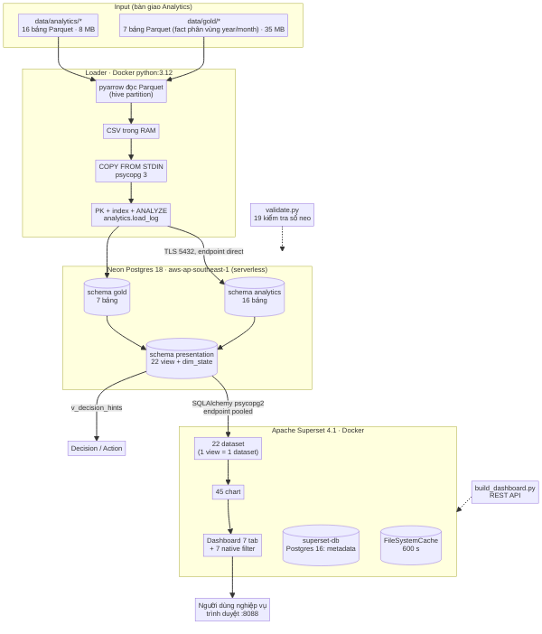

# Olist E-commerce · Analytics → Presentation

Đồ án học phần **Nhập môn Dữ liệu lớn** (thầy Sang – chiều thứ 4) — nhóm phụ trách quy trình con **Analytics → Presentation**.

Nhận output Parquet của nhóm Analytics (bộ dữ liệu thương mại điện tử Olist, Brazil, 2016–2018), nạp vào
**Neon Postgres** (serverless, AWS Singapore), xây **tầng ngữ nghĩa** bằng view SQL và trình bày trên dashboard
**Apache Superset** (7 tab, 45 chart, 7 bộ lọc native, có mục *Gợi ý quyết định* nối sang giai đoạn Decision/Action).
Toàn bộ chạy bằng Docker, dựng lại được bằng script — không cần cài Python lên máy.



## 1. Vị trí trong pipeline và ranh giới



| | Nội dung |
|---|---|
| **Bắt đầu (input)** | `data/analytics/<bảng>/part-*.parquet` (16 bảng, 8 MB) và `data/gold/` (7 bảng, 35 MB, fact phân vùng `purchase_year/purchase_month`) do nhóm Analytics bàn giao — xem `docs/upstream/ANALYTICS_HANDOVER.md`. Repo đã chứa sẵn bản sao, không cần repo khác. |
| **Kết thúc (output)** | (1) 25 bảng (23 nạp từ Parquet + `analytics.load_log` + `presentation.dim_state`) và 22 view trên Neon; (2) dashboard Superset tại `http://localhost:8088`; (3) view `presentation.v_decision_hints` (luật + ngưỡng + hành động) để nhóm Decision/Action đọc bằng SQL. |
| **Không làm** | Không chạy lại Spark, không sửa số liệu Analytics; mọi KPI hiển thị đều truy về bảng Analytics/gold và được đối chiếu số neo. |

Sơ đồ chi tiết: [`docs/architecture.md`](docs/architecture.md) · ảnh PNG: [`docs/architecture.png`](docs/architecture.png).



## 2. Vì sao là bài toán Big Data

- **Volume / Variety:** ~505 nghìn dòng qua 23 bảng (fact đơn hàng, dòng sản phẩm, khách, seller, bảng KPI, kết quả
  K-Means), nhiều kiểu dữ liệu (decimal, date, timestamp, boolean, chuỗi), fact phân vùng theo tháng.
- **Veracity:** dữ liệu có cờ chất lượng `dq_*`, tháng thiếu dữ liệu, khách trùng `customer_id`; tầng trình bày giữ đúng
  quy tắc bàn giao (khung 2017-01→2018-08, đếm `customer_unique_id`, review cấp đơn) và tự kiểm 19 số neo.
- **Khả năng mở rộng:** phần tính toán nặng chạy phân tán ở Spark (nhóm trước); Presentation đọc bảng đã tổng hợp nên
  độ trễ không tăng theo dữ liệu nguồn. Thí nghiệm ×1→×10 (1,12 triệu dòng) trên Neon: truy vấn trên dữ liệu thô tăng
  tuyến tính 47 → 507 ms, còn view tổng hợp giữ ~1,1 ms (`evidence/scale_experiment.md`).

## 3. Công nghệ và lý do chọn

| Công nghệ | Vai trò trong kiến trúc | Lý do chọn |
|---|---|---|
| **Parquet + pyarrow** | Định dạng nhận từ Analytics, đọc kể cả thư mục phân vùng hive | Giữ nguyên kiểu Spark (decimal, date); không cần Spark để đọc |
| **Python loader** (`loader/`) trong Docker `python:3.12-slim` | Tạo bảng đúng kiểu Postgres, `COPY FROM STDIN`, khoá chính/index, ghi `analytics.load_log` | Máy Windows không có Python; COPY nạp hàng loạt nhanh hơn INSERT; chạy lại được |
| **Neon Postgres 18** (serverless, aws-ap-southeast-1) | Serving layer cho dashboard: schema `analytics`, `gold`, `presentation` | SQL chuẩn, tách compute/storage, autoscale & scale-to-zero, branching; Superset hỗ trợ sẵn; không phải tự vận hành DB |
| **View SQL** (`sql/10_presentation_views.sql`) | Semantic layer: mỗi view phục vụ một nhóm chart, thêm nhãn, mã ISO bang, luật cảnh báo | Logic KPI nằm trong SQL có version control; dashboard không tự tính lại số |
| **Apache Superset 4.1.2** (Docker) | Dashboard, chart, bộ lọc native, cache kết quả | Mã nguồn mở, REST API cho phép **dựng dashboard bằng code** (tái lập), có Country Map Brazil |
| **Postgres 16** (`superset-db`) | Metadata của Superset | SQLite khoá ghi toàn cục, làm các chart tải song song phải xếp hàng |
| **Playwright** (Docker) | Chụp ảnh minh chứng, đo thời gian tải dashboard và từng chart | Tự động, chạy lại được |

## 4. Cấu trúc repo

```
├── data/
│   ├── analytics/          # INPUT: 16 bảng Parquet output Analytics
│   └── gold/               # INPUT: 7 bảng gold (fact phân vùng year/month)
├── docs/
│   ├── architecture.md     # sơ đồ data-flow, giao thức, khả năng mở rộng (+ architecture.png)
│   └── upstream/           # tài liệu bàn giao của nhóm Analytics/Processing
├── loader/                 # load_to_neon.py, validate.py, apply_sql.py, Dockerfile, requirements.txt
├── sql/
│   ├── 10_presentation_views.sql   # semantic layer (schema presentation)
│   └── 90_anchor_checks.sql        # 19 kiểm tra số neo
├── superset/               # Dockerfile, superset_config.py, build_dashboard.py, import_dashboard.py, dashboard.css
│   ├── branding/           # logo + favicon Olist Insight (đồng bộ landing page)
│   ├── templates/          # tail_js_custom_extra.html: font + CSS chung (thanh menu, trang đăng nhập)
│   ├── i18n/               # bản dịch tiếng Việt cho giao diện Superset (messages.po + build_catalog.py)
│   └── export/             # ZIP + YAML export dashboard, build_info.json
├── scripts/                # đo latency, thí nghiệm scale, chụp ảnh, vẽ sơ đồ, kiểm kê Neon
├── web/                    # landing page tĩnh (nginx :8090); data/kpi.json xuất từ Neon
├── evidence/               # log, CSV/MD số liệu, ảnh chụp
├── report/                 # báo cáo đồ án (docx/pdf) và script sinh báo cáo
├── docker-compose.yml
└── .env.example
```

## 5. Cài đặt và chạy end-to-end

Yêu cầu: Docker Desktop (đã thử với Docker 29), Git, kết nối Internet, một database Neon (gói free đủ dùng).

```powershell
git clone https://github.com/viettuong287/BigDataProject.git
cd BigDataProject
copy .env.example .env      # điền NEON_DATABASE_URL (endpoint pooled), SUPERSET_SECRET_KEY, mật khẩu admin
```

**Bước 1 – build image công cụ và nạp dữ liệu vào Neon** (~5–6 phút, phụ thuộc băng thông upload):

```powershell
docker compose build tools
docker compose run --rm tools python loader/load_to_neon.py     # tạo schema, COPY 23 bảng, index, view
docker compose run --rm tools python loader/validate.py         # đối chiếu số dòng + 19 số neo
```

Loader tự bỏ `-pooler` khỏi hostname để COPY/DDL qua endpoint direct. Chạy lại chỉ phần view:
`docker compose run --rm tools python loader/apply_sql.py`.

**Bước 2 – bật Superset và dựng dashboard từ code** (~4 phút lần đầu):

```powershell
docker compose up -d superset-db superset        # đợi trạng thái healthy
docker compose run --rm tools python superset/build_dashboard.py
```

Mở **http://localhost:8088/superset/dashboard/olist-presentation/** – đăng nhập `admin` / mật khẩu trong `.env`
(mặc định `admin`). Script idempotent: chạy lại sẽ cập nhật chart/dashboard; `--no-refresh` bỏ qua bước đọc lại cột
dataset. Phương án dự phòng: `docker compose run --rm tools python superset/import_dashboard.py` import từ
`superset/export/dashboard_olist_presentation.zip` (điền thông tin kết nối từ `.env`).

> Nếu đang mở dashboard trong trình duyệt khi chạy lại `build_dashboard.py`, hãy tải lại trang: Superset 4.1 tự lưu
> trạng thái dashboard của tab cũ và có thể ghi đè cấu hình bộ lọc vừa dựng.

**Ngôn ngữ giao diện – tiếng Việt.** Superset 4.1.2 không có sẵn gói `vi`, nên repo kèm bản dịch riêng
`superset/i18n/vi/LC_MESSAGES/messages.po` (536 chuỗi hay gặp: menu, trang đăng nhập, trang chủ, thanh tiêu đề và menu
dashboard, thanh bộ lọc, bộ chọn thời gian, menu "⋮" của biểu đồ, nút chung, một phần màn hình sửa biểu đồ).
Khi build image, `superset/i18n/build_catalog.py` biên dịch thành `messages.mo` (backend) và `messages.json`
(frontend) trong `superset/translations/vi/`. `superset_config.py` đặt `BABEL_DEFAULT_LOCALE = "vi"`, giữ English trong
bộ chọn ngôn ngữ (cờ ở góc phải thanh menu) và dùng định dạng số/ngày kiểu Việt Nam (`13.494.400,74`).
Sau khi sửa `messages.po`: `docker compose build superset && docker compose up -d superset`. Tên dashboard, tab,
biểu đồ, nhãn cột/metric và bộ lọc là tiếng Việt, đặt trong `build_dashboard.py`.
Phần còn tiếng Anh: chuỗi chưa có trong bản dịch (chủ yếu ở SQL Lab, màn hình sửa biểu đồ, trang quản trị), nút
"All/Inv" của chú giải ECharts, chữ "… ago" cạnh tên người sửa, ô tìm kiếm/phân trang riêng của biểu đồ bảng
("153 record") và giá trị dữ liệu gốc (tên danh mục, phân khúc RFM như *Champions*, *At Risk*).

**Giao diện đồng bộ với landing page (thương hiệu Olist Insight).** Superset dùng cùng nhận diện với `web/`:
- *Thương hiệu* (`superset_config.py`): `APP_NAME = "Olist Insight"`, logo ngang + favicon trong `superset/branding/`
  (Dockerfile chép vào `/static/assets/images/olist/`); bấm logo về landing page (`LOGO_TARGET_PATH`, đổi bằng biến
  môi trường `LANDING_URL`, mặc định `http://localhost:8090/`); nút "Trang giới thiệu" ở thanh menu phải (`DOCUMENTATION_URL`).
- *Theme* (`THEME_OVERRIDES`): màu chính chàm `#6366f1`, phụ xanh ngọc `#10b981`, thang xám xanh (slate), bo góc 8 px,
  font **Be Vietnam Pro** (đủ dấu tiếng Việt, nạp từ Google Fonts; mất mạng thì rơi về Inter/Segoe UI).
- *Bảng màu chart*: `olistInsight` (phân loại, mặc định – doanh thu xanh ngọc, số đơn chàm như biểu đồ hero của landing)
  và `olistInsightSeq` (liên tục xanh ngọc → chàm cho bản đồ Brazil, heatmap); `build_dashboard.py` gán cho mọi chart.
- *CSS*: `superset/templates/tail_js_custom_extra.html` (mọi trang: font, thanh menu kính tối, trang đăng nhập) và
  `superset/dashboard.css` (riêng dashboard, `build_dashboard.py` ghi vào trường `css` nên có trong ZIP export): nền
  gradient + blob như landing, tab dạng pill, thanh bộ lọc kính tối, thẻ KPI/markdown kính tối, còn thẻ biểu đồ là
  **kính sáng** để chữ trục, chú giải, bảng của ECharts luôn dễ đọc.
- Giới hạn của Superset 4.1: chưa có dark mode thật cho chart (ECharts/bảng vẽ chữ tối) nên không đặt chart trên nền tối;
  phần chữ vẽ trên canvas ECharts dùng font hệ thống; màn hình sửa biểu đồ/SQL Lab chỉ đổi màu theme và thanh menu.

Sửa logo/template: `docker compose build superset && docker compose up -d superset`; sửa `dashboard.css` hay bảng màu
chart: chạy lại `build_dashboard.py`. Ảnh: `docker compose run --rm screenshots python scripts/screenshot_giao_dien.py`
→ `evidence/superset_giao_dien_dong_bo_*.png`.

**Bước 3 – tái tạo minh chứng (tuỳ chọn):**

```powershell
docker compose run --rm tools python scripts/measure_latency.py      # độ trễ 22 truy vấn dashboard
docker compose run --rm tools python scripts/scale_experiment.py     # thí nghiệm ×1, ×2, ×5, ×10
docker compose run --rm tools python scripts/neon_inventory.py       # kiểm kê bảng/view trên Neon
docker exec olist-superset bash -c 'rm -rf /app/superset_home/cache/*'
docker compose run --rm screenshots                                  # ảnh + thời gian tải cold/cache
docker compose run --rm screenshots python scripts/render_diagrams.py  # PNG sơ đồ + ảnh kiểm kê Neon
```

**Bước 4 – landing page giới thiệu (tuỳ chọn):**

```powershell
docker compose run --rm tools python scripts/export_landing_kpi.py   # xuất số liệu thật từ Neon → web/data/kpi.json
docker compose up -d web                                             # nginx phục vụ web/ tại http://localhost:8090
docker compose run --rm screenshots python scripts/screenshot_landing.py  # ảnh desktop + mobile vào evidence/
```

Mở **http://localhost:8090** – trang tĩnh tiếng Việt, phong cách glassmorphism, gồm: hero có biểu đồ *live replay*
phát lại doanh thu/đơn hàng 20 tháng (2017-01→2018-08) từ `presentation.v_kpi_monthly` kèm 5 thẻ KPI cập nhật theo
tháng; huy hiệu kiểm chứng (19/19 số neo, 23/23 bảng); 6 tính năng; insight thật (top danh mục, bang, phân khúc RFM,
cảnh báo từ `v_decision_hints`); dải pipeline; bảng giá minh hoạ; footer thông tin nhóm. Trang chỉ đọc
`web/data/kpi.json` (không giữ thông tin kết nối Neon) — chạy lại script xuất sau mỗi lần nạp để cập nhật số.

Tắt hệ thống: `docker compose down` (thêm `-v` sẽ **xoá** metadata Superset; dữ liệu trên Neon không bị ảnh hưởng).

## 6. Data contract – dữ liệu trên Neon

Mỗi bảng có `COMMENT` ghi grain và đường dẫn nguồn. Số dòng đã đối chiếu 23/23 với Parquet (`evidence/validation.md`).

| Schema | Bảng | Số dòng | Grain (1 dòng =) | Khoá |
|---|---|---:|---|---|
| analytics | kpi_monthly | 20 | 1 tháng 2017-01→2018-08 | (purchase_year, purchase_month) |
| analytics | category_pareto / category_seasonality | 74 / 715 | 1 danh mục / danh mục × tháng 2017 | category / (category, purchase_month) |
| analytics | state_logistics / insight_distance | 27 / 4 | 1 bang / 1 band khoảng cách | customer_state / distance_band |
| analytics | rfm_scores / customer_segments | 94.983 / 94.983 | 1 khách thật (+ cụm K-Means) | customer_unique_id |
| analytics | repeat_profile / repeat_categories / repeat_states / cluster_profile | 2 / 70 / 27 / 4 | cohort / danh mục / bang / cụm | cột nhóm |
| analytics | seller_pareto / seller_watchlist | 3.053 / 153 | 1 seller | seller_id |
| analytics | insight_late_vs_review / delay_vs_review / payment_mix | 2 / 5 / 10 | nhóm giao hàng / band trễ / PTTT × kỳ góp | cột nhóm |
| analytics | load_log | mỗi lần nạp +23 | 1 bảng × 1 lần nạp | id |
| gold | fact_orders / fact_order_items | 99.441 / 112.650 | 1 đơn / 1 dòng sản phẩm | order_id / (order_id, order_item_id) |
| gold | agg_sales_monthly / agg_category_monthly / agg_customer_state / agg_seller_performance / agg_customer_rfm | 24 / 1.282 / 27 / 3.053 / 94.983 | tháng / danh mục×tháng / bang / seller / khách | như grain |

**Semantic layer (`presentation`)** – 22 view + bảng `dim_state` (tên bang, vùng, mã ISO `BR-XX` cho bản đồ):
`v_kpi_monthly`, `v_orders` (đơn hợp lệ trong khung KPI, nguồn thẻ KPI có lọc), `v_kpi_overview`, `v_category_pareto`,
`v_category_seasonality`, `v_category_monthly`, `v_sales_items`, `v_state_logistics`, `v_insight_distance`,
`v_rfm_customers`, `v_rfm_segments`, `v_cluster_profile`, `v_repeat_profile`, `v_repeat_categories`, `v_repeat_states`,
`v_seller_pareto`, `v_seller_watchlist` (số vi phạm, lý do, mức ĐỎ/VÀNG, hành động), `v_late_vs_review`,
`v_delay_vs_review`, `v_payment_mix`, `v_decision_hints` (7 luật), `v_load_log`.

## 7. Dashboard

| Tab | Nội dung chính |
|---|---|
| 1 · Tổng quan & xu hướng | 6 thẻ KPI (doanh thu, đơn, khách, AOV, % trễ, review), big number có trendline, doanh thu & đơn theo tháng, % trễ vs review, MoM, bảng KPI có tô màu |
| 2 · Danh mục & mùa vụ | Pareto top 25 (cột + đường cộng dồn), heatmap mùa vụ 2017, ship/doanh thu theo danh mục, xu hướng 6 danh mục lớn |
| 3 · Địa lý & logistics | Country Map Brazil, bubble ngày giao vs review theo bang, % trễ theo bang, khoảng cách → ship & % trễ, bảng 27 bang |
| 4 · Khách hàng & RFM | 4 thẻ (khách, khách mua lại, tỷ lệ 3,04%, chi tiêu TB), donut phân khúc RFM, cụm K-Means, danh mục/bang của khách lặp, bảng hành động CRM |
| 5 · Người bán | 4 thẻ (3.053 người bán, 539 = 80% doanh thu, 17,65%, 153 cần theo dõi), Pareto nhóm A/B/C, bubble top 300 người bán, **bảng watchlist cảnh báo** |
| 6 · Giao trễ, đánh giá & thanh toán | Review trễ vs đúng hạn, ngưỡng ngày trễ vs % 1 sao, payment mix, AOV theo kỳ góp |
| 7 · Gợi ý quyết định & nguồn dữ liệu | Bảng 7 luật quyết định, giải thích, nhật ký nạp dữ liệu (lineage) |

**Bộ lọc native:** Khoảng thời gian, Bang khách hàng, Vùng, Danh mục, Phân khúc RFM, Phương thức thanh toán, Bang người bán.
Mỗi bộ lọc chỉ áp dụng cho chart có cột tương ứng (phạm vi tính tự động trong `build_dashboard.py`).

**Gợi ý quyết định (sang Decision/Action):** 75/153 seller watchlist vi phạm ≥ 2 tiêu chí (mức ĐỎ); đơn trễ kéo review
4,29 → 2,56; tháng trễ > 15% (03/2018, 02/2018); 9 bang trễ > 10% và review < 4; ngành phí ship > 20%; 1.961 khách
At Risk; 17,65% seller tạo 80% doanh thu.

## 8. Kết quả và minh chứng (`evidence/`)

| Hạng mục | Kết quả | Tệp |
|---|---|---|
| Nạp dữ liệu | Lần chạy 13/11/2026: 23 bảng, 505.592 dòng, Parquet 42,9 MB, 285 s (đọc + COPY + index); COPY 1.972 dòng/s (nút thắt là upload ~0,25–0,75 MB/s từ máy local) | `load_run.log`, `load_log.csv` |
| Kiểm chứng | 23/23 bảng khớp số dòng; 19/19 số neo đạt (SUM revenue = 13.494.400,74; đỉnh 11/2017 MoM +52,06%; review 2,56 vs 4,29; mua lại 2.887/94.983 = 3,04%) | `validation.md`, `validation.json` |
| Độ trễ truy vấn | 21 truy vấn dashboard: trung vị 173 ms phía client, 1,25 ms phía server; RTT 105 ms; kết nối TLS mới 1,1 s | `query_latency.md/.csv` |
| Thời gian tải dashboard | Tab: trung vị 6,6 s cold → 1,2 s khi có cache; chart qua API: 1.880 ms → 75 ms (đo 13/11/2026) | `dashboard_load_latency.md`, `dashboard_load_time.csv`, `superset_chart_latency.csv` |
| Thí nghiệm scale | ×10 = 1,12 triệu dòng: dữ liệu thô 47 → 507 ms, view tổng hợp 1,1 ms; sinh dữ liệu ~1 triệu dòng/s phía server | `scale_experiment.md/.csv` |
| Ảnh dashboard | 7 tab | `dashboard_tab1…7_*.png` |
| Ảnh bộ lọc | 6 kịch bản (thời gian + bang, danh mục, vùng, RFM + bang, bang người bán, PTTT), giao diện tiếng Việt | `filter_*.png` |
| Ảnh cảnh báo | Bảng watchlist, bảng gợi ý quyết định | `watchlist_*.png` |
| Giao diện tiếng Việt | Trang đăng nhập, dashboard + thanh bộ lọc, menu biểu đồ, bảng người bán (`scripts/screenshot_tieng_viet.py`) | `superset_tieng_viet_*.png` |
| Neon | Kiểm kê 25 bảng + 22 view, số dòng, dung lượng (146 MB), thông tin project | `neon_tables_inventory.png`, `neon_inventory.csv`, `neon_project.json` |
| Kiến trúc | Sơ đồ data-flow | `architecture_pipeline.png`, `docs/architecture.png` |
| Landing page | Trang giới thiệu tại `:8090`, số liệu thật từ Neon, chụp ở 1440 px và 390 px (không lỗi JS) | `landing_page_desktop.png`, `landing_page_mobile.png` |
| Giao diện đồng bộ | Superset mang thương hiệu Olist Insight: đăng nhập, 7 tab (0 chart lỗi), ảnh so sánh landing ↔ dashboard (`scripts/screenshot_giao_dien.py`) | `superset_giao_dien_dong_bo_*.png` |

## 9. Hạn chế đã biết

- Neon Console cần đăng nhập tương tác nên ảnh `neon_tables_inventory.png` được sinh từ truy vấn catalog trực tiếp
  trên database (không phải ảnh chụp Console).
- Tốc độ nạp bị giới hạn bởi băng thông upload của máy chạy loader; trong triển khai thật nên chạy loader cùng region.
- Superset dùng NullPool nên mỗi chart mở kết nối TLS mới (~1,1 s) — lần mở đầu chậm, có cache thì ~1 s/tab.
- Metadata Superset nằm trong volume Docker cục bộ; dashboard được tái tạo bằng `build_dashboard.py` hoặc ZIP export.
- Gói Neon free giới hạn compute 0,25 CU và 1 GiB/branch; thí nghiệm scale dừng ở ×10 và xoá bảng tạm sau khi đo.

## 10. Ghi chú về công cụ AI

Mã nguồn, SQL và tài liệu được viết với sự hỗ trợ của trợ lý AI (Cursor); nhóm đã chạy, kiểm tra số liệu (19 số neo,
ảnh dashboard) và chịu trách nhiệm về nội dung.
