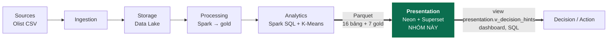
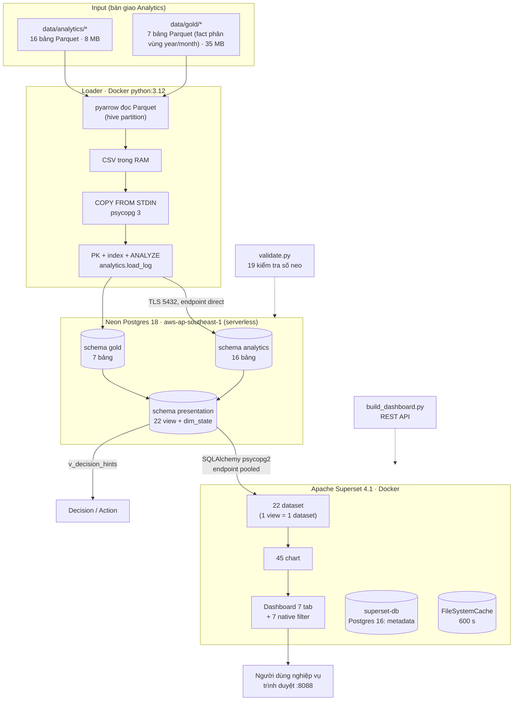

# Kiến trúc giai đoạn Analytics → Presentation

Tài liệu mô tả luồng dữ liệu từ output của nhóm Analytics tới dashboard cho người dùng nghiệp vụ.
Ảnh PNG của sơ đồ: `docs/architecture.png` (và bản sao `evidence/architecture_pipeline.png`),
sinh lại bằng `docker compose run --rm screenshots python scripts/render_diagrams.py`.

## 1. Vị trí trong pipeline

- **Ranh giới bắt đầu:** thư mục `data/analytics/<bảng>/part-*.parquet` và `data/gold/` do nhóm Analytics bàn giao
  (`docs/upstream/ANALYTICS_HANDOVER.md`). Nhóm không chạy lại Spark, không sửa số liệu.
- **Ranh giới kết thúc:** dashboard Superset (7 tab, 45 chart, 7 bộ lọc native) và view
  `presentation.v_decision_hints` để giai đoạn Decision/Action đọc bằng SQL.

## 2. Luồng dữ liệu chi tiết

## 3. Thành phần và lý do chọn

| Thành phần | Vai trò | Vì sao chọn |
|---|---|---|
| Parquet (input) | Định dạng bàn giao của Analytics | Cột, nén snappy, giữ kiểu decimal/date của Spark; đọc trực tiếp bằng pyarrow |
| Python loader trong Docker | Đọc Parquet, COPY vào Postgres, ghi log | Máy Windows không cần cài Python; COPY nhanh hơn INSERT nhiều lần |
| Neon Postgres (serverless) | Tầng phục vụ (serving layer) cho dashboard | Postgres chuẩn SQL, tách compute/storage, autoscale/scale-to-zero, branching; Superset hỗ trợ sẵn |
| Schema `presentation` (view) | Semantic layer: mỗi view = 1 nhóm chart | Logic hiển thị nằm trong SQL có version control; dashboard không tự tính lại KPI |
| Apache Superset 4.1 | Dashboard, bộ lọc, phân quyền | Mã nguồn mở, chạy Docker, có REST API để dựng dashboard bằng code (tái lập) |
| superset-db (Postgres 16) | Metadata Superset | SQLite khoá ghi toàn cục làm các chart tải song song phải xếp hàng |
| Playwright (Docker) | Chụp ảnh, đo thời gian tải | Tự động hoá minh chứng, chạy lại được |

## 4. Giao thức và định dạng

| Đoạn | Giao thức / định dạng |
|---|---|
| Analytics → loader | File Parquet (snappy) trên đĩa, partition `purchase_year=/purchase_month=` |
| Loader → Neon | PostgreSQL wire protocol trên TLS, lệnh `COPY ... FROM STDIN (FORMAT csv)`, endpoint direct |
| Superset → Neon | SQLAlchemy + psycopg2, endpoint pooled (PgBouncer), kết quả cache 600 s |
| Người dùng → Superset | HTTP :8088, JSON `/api/v1/chart/data` |
| Presentation → Decision | SQL trên `presentation.v_decision_hints` (mỗi dòng = 1 luật, ngưỡng, giá trị, hành động) |

## 5. Khả năng mở rộng

- **Tách tính toán nặng và phục vụ:** phần nặng (join 100k+ dòng, K-Means) đã làm ở Spark; Presentation chỉ đọc bảng
  tổng hợp nhỏ nên độ trễ truy vấn phía server ~1 ms cho hầu hết view (xem `evidence/query_latency.md`).
  Khi dữ liệu nguồn tăng ×10, các bảng tổng hợp gần như không đổi kích thước (20 tháng, 74 danh mục, 27 bang).
- **View trên fact** (`v_orders`, `v_sales_items`) có index theo ngày/bang/danh mục; khi dữ liệu lớn hơn có thể chuyển
  sang materialized view hoặc bảng partition theo tháng mà không đổi dashboard (dataset trỏ theo tên view).
- **Neon** autoscale compute (giới hạn 0,25 CU ở gói free), có read replica và branch để thử nghiệm mà không ảnh hưởng
  dashboard; **Superset** scale ngang bằng thêm worker gunicorn/Celery và cache Redis.
- **Nút thắt đo được:** upload từ máy local lên Neon (0,3–0,9 MB/s CSV) và bắt tay TLS (~1,1 s/kết nối mới). Trong
  triển khai thật loader nên chạy cùng region với Neon (vd. job trên cloud) và Superset nên dùng pool kết nối.
